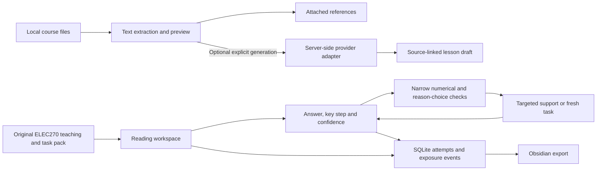

# Learning Studio

## Current application: ELEC270 local pilot

The default entry is now a React / FastAPI learning app with local accounts, course import, SQLite storage, diagnosis, teaching, photo transcription, confirmed answers, feedback, private records and Obsidian export. Ramp construction includes a Chinese/English guided lesson with interactive graphs and checkpoint-based routing. See [PILOT.md](PILOT.md) for the current feature scope, configuration and limits.

This repository includes application code, schema migrations, authored examples and tests. **Personal databases, uploaded photos, API keys, Obsidian notes and university course originals are not distributed.** The database is created locally on first run; PostgreSQL is an optional, not yet integration-tested configuration. This is a local-only pilot, not a production hosting release.

### Start on a new machine

Requirements: Python 3.10+ and Node.js 20.19+ / 22.12+. On macOS, configure your material locations in a local `.env` (use `.env.example` as a template), then run `./start.command`. The importer expects `10 Y2上学期/ELEC270 信号与系统/Weeks/*.md` inside your vault; provide `STUDIO_VAULT_ROOT` and `STUDIO_ELEC270_SOURCES` for your own files. Without that private course structure, use the manual setup below and open `http://127.0.0.1:8765/?prototype=1` to try the included original English sample. The sample does not require private materials or an API key.

For the default pilot, import course files with:

```sh
.venv/bin/python -m alembic upgrade head
.venv/bin/python -m backend.pilot.import_course --vault /path/to/Obsidian --desktop /path/to/ELEC270-materials
```

The guided lesson and numerical checks run locally. Optional photo recognition and AI process feedback use `OPENAI_API_KEY` plus `STUDIO_VISION_MODEL`; keep `.env` private. The rest of this README documents the preserved original prototype at `/?prototype=1`.

## Original prototype

A local, English-language prototype of the STEM Study Vault learning loop. Built for an academic discussion, with an original ELEC270 Week 1 signal-construction unit.

**Run on macOS:** double-click `start.command`, then open **http://127.0.0.1:8765**. Keep its terminal window open during the demonstration. The first setup on another machine requires Python 3.10+, Node 20.19+ / 22.12+, and internet access to install dependencies. Subsequent prepared demonstrations work offline. Dependencies are isolated inside this app.

## What works now

- Import PDF, PPTX, Markdown or UTF-8 text; inspect extracted pages and download the original. Limit: three files per unit, 10 MB each, 60 pages/slides, 60,000 text characters per file.
- Read three connected English sections, rendered mathematics and an interactive ramp comparison.
- Submit numerical answers, a reasoning choice, a written key step and confidence.
- Receive different authored support for substitution errors, slope/height confusion and construction errors.
- Open graduated support or a worked answer; attempt up to six distinct fresh constructions.
- Inspect the six evidence dimensions, withdraw an incorrect observation, save notes and resume after refresh or restart.
- Export a usable Obsidian folder with lessons, exercises, folded answers, an original SVG, personal notes, source material and the complete learning record.

**No API key is needed for this flow.** Prepared teaching is not generated from uploaded files. Those files are retained as separately labelled references. The application says so at import and in Sources & scope.

## Two explicitly separate modes

| Mode | Teaching | Assessment | Network use |
| --- | --- | --- | --- |
| Prepared ELEC270 | Original authored unit and support branches | Deterministic numerical and selected-reason checks | None |
| Optional uploaded-source draft | One server-side model request over extracted source text | No reviewed task pack; no invented assessment | Configured OpenAI or DeepSeek API |

The live adapter has contract tests with mocked responses. **This legacy source-draft adapter has not been tested against a real provider.** The newer pilot photo/feedback adapter has a separate validation record. General AI tutoring, automatic assessment-pack generation and complete-course generation are outside this prototype. The sample covers a focused part of Week 1, not the full lecture.

## A ten-minute demonstration

See [DEMO.md](DEMO.md) for the English walkthrough, exact example answers and questions for the professors. Open a new sample from **My workspace → Open sample unit** for a clean demonstration. Existing records are not reset.

The development walkthrough stored on this computer is a scripted developer test, **not student evidence**. Its personal note states this. Do not present its attempts as validation of learning effectiveness.

## Architecture and evidence

React + TypeScript provide the reading workspace. A local FastAPI service extracts source text, applies deterministic checks, records events and exports Markdown. SQLite stores sessions and imported-source metadata. Raw imports live in the ignored `data/` directory.



The current implementation translates source-linked teaching and evidence discipline into an interface. It does **not** yet run the entire repository Skill as an agent. It does not infer IQ, fixed learning styles, personality or a general ability score. Nuwa-inspired evidence-to-teaching adaptation is represented by revisable, task-specific observations, not a personality clone.

A correct checkpoint is **guided/supported**. A first correct fresh construction without recorded task-specific exposure is an **independent task check**, limited to the numerical fields and selected explanation. It is near transfer within one task family; it does not establish broad transfer or mastery. Written explanations are stored but not semantically graded. Delayed retention is unassessed.

Hints, answers, previous attempts, general help for already opened tasks, and exporting worked answers count as exposure. Withdrawing an observation removes it from current claims without erasing exposure history. Reading progress is distinct from understanding. A student can continue without passing a gate.

## Optional model configuration

Copy `.env.example` to `.env` inside this directory. Set a provider, a model identifier supported by that provider's Chat Completions JSON mode, and that provider's API key. Restart the server. Never place a key in frontend code or commit `.env`.

One explicit generation sends extracted text to the provider. There is one bounded request, a 6,000-token output cap, a 90-second timeout and no automatic retries. Rejected or timed-out calls may still incur provider charges. This is a request cap, not a monetary billing system. No subscription, credits or payments are implemented.

The model response must pass a structural schema and exact source-ID checks. This does not prove that its claims faithfully follow those sources. Incomplete or invalid responses do not create a lesson. Prompt injection in uploaded documents is treated as untrusted source data; the model has no tools. Generated HTML and embedded images are not rendered.

Provider interface references: [OpenAI Chat Completions](https://developers.openai.com/api/reference/resources/chat/subresources/completions/methods/create), [DeepSeek JSON output](https://api-docs.deepseek.com/guides/json_mode/).

## Development

```sh
python3 -m venv .venv
.venv/bin/pip install -r requirements.txt
npm ci
npm run build
.venv/bin/python -m uvicorn backend.app:app --host 127.0.0.1 --port 8765
```

For frontend development, run `npm run dev` alongside the backend; Vite uses port 5177 and proxies `/api` to 8765. Production builds include KaTeX fonts locally, without a CDN. One worker only: session updates use a process-local lock.

```sh
.venv/bin/python -m unittest discover -s tests -v
npm run build
```

Tests use temporary storage, mocked provider calls and original fixtures, never the live workspace or paid API. See [VALIDATION.md](VALIDATION.md) for the observed result and limits.

## Storage and deployment boundary

`data/studio.sqlite3` contains local notes, attempts, extracted text and generation records. Originals are stored beside it. Back up `data/` with the server stopped if you need a full local backup; export gives portable learning content but is not yet an importable application backup. Deleting a unit retains independently imported originals. There is no remote telemetry.

This is a single-user loopback prototype, not a deployable student portal. Do not bind it to a public interface. Authentication, account isolation, encrypted hosted storage, source-image/OCR processing, multi-worker transaction design, a validated open-response evaluator and study consent/data governance require separate implementation before a student pilot. Browser tabs on this one local workspace do not have concurrent-edit conflict resolution. Unsubmitted answer drafts are not persisted; submitted attempts and saved notes are.

## ELEC270 第一版（2026-10-10）

默认入口现在是 ELEC270 试点，见 [PILOT.md](PILOT.md)。原始演示入口保留在 `/?prototype=1`。新功能包括真实课程导入、独立账号、三主题诊断/反馈、照片与确认、学习记录及 Skill V1 导出。模型未配置时可用数值检查和手动转录；自动识别与 AI 过程反馈须配置后实测。

## Invited-pilot milestone (11 October 2026)

The primary interface, authored tasks for all three pilot topics, deterministic feedback, hints and examples now support Chinese/English. Language is saved to the account. Source documents and learner writing remain in their original language; historical evidence is retained. AI feedback is requested in the chosen language; multilingual AI quality has only mock-contract coverage so far.

The new study-plan page suggests continuing an unfinished problem, revisiting an error, trying fresh practice or a due review. Suggestions do not certify mastery or retention. Answer drafts autosave separately from attempts, resume after refresh, detect conflicting edits and are included in raw personal export. Guided checkpoint inputs and unsaved personal notes are still distinct from these practice-answer drafts.

For the prepared shared-URL deployment path, exact user login/billing handoff, hosted limits and the backup/restore drill, see [DEPLOYMENT.md](DEPLOYMENT.md). `render.yaml` and the Dockerfile prepare a small single-process invitation pilot. No cloud service has been created or charged by this change. The initial cloud seed contains only distributable authored material, not the local private course.
